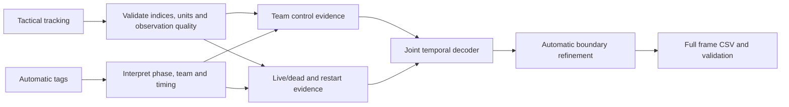

**Detailed reference — More than a Hack 2027, Phase 1**

The shorter working plan is in `APPROACH_PLAN.md`. This document preserves the full repository audit and implementation considerations for later reference. Registration was completed on 3 November 2026; the match footage has not yet been received, so data-dependent work begins only when the authorized bundle becomes available.

Prepared 3 November 2026 against repository commit `f8f2629`. This is a proposed implementation and experiment plan, not a claim of achieved model performance.

**Recommendation**

Build an offline temporal segmentation system using tactical tracking and Smart Tagging first. Estimate evidence for ball alive/dead separately from evidence for home/away control, then reconcile both in one sequence decoder. Preserve possession through passes, occlusions and contested balls; change it on convincing control or stoppage evidence. Use future observations to confirm an event and locate its onset automatically.

Start with a transparent state machine and a three-state Viterbi decoder. Add explicit duration modeling only if external validation supports it. Local video processing and broadcast fusion are optional later improvements. The most defensible initial investment is in missing-ball handling, stoppages/restarts, control transitions and validation.

**What was reviewed and what is available**

The review covered all challenge/rules/data/submission documentation; `games.py`; all evaluation scripts; the public metadata and supplied baseline predictions; all starter Python modules; the code and explanatory cells in all three notebooks; dependencies, ignore rules and license.

The checkout was clean before adding this plan. All nine expected tactical/broadcast asset paths are absent from the configured `data/` directory. No restricted match assets were inspected. The repository has working evaluation and starter code, but no custom solution, experiment framework, external validation dataset or automated test suite in the tracked file inventory.

The existing environment runs Python 3.12.2, NumPy 2.5.4 and pandas 3.1.0. Read-only evaluation reproduced the supplied public baseline scores, and all four baseline files passed the submission validation function. This verifies the local evaluation path; it does not regenerate baselines from tracking, because tracking is absent.

| Supplied baseline | Public macroF1 | Public spellF1 | Published full-match spellF1 |
|---|---:|---:|---:|
| raw | 0.5972 | 0.0378 | 0.0486 |
| smooth25 | 0.6200 | 0.2868 | 0.1996 |
| smooth50 | 0.6207 | 0.3256 | 0.2433 |
| smooth125 | 0.5812 | 0.4242 | 0.2242 |

The full-match column is reported by the organizers in `EVALUATION.md`, not measured locally. The public ranking reverses smooth50/smooth125 and must not be used to choose a method. No model was selected or tuned during this review.

**1. The objective and the constraints that determine the design**

- Produce exactly 199,319 rows at 25 fps, indexed to the tactical video, with `H`, `A`, `D` or `X`.
- `H`/`A` mean controlled team possession while the ball is live. Loose or contested play retains the last controller; an incidental opposition touch does not automatically transfer possession.
- `D` means dead ball, regardless of who will restart. `H → D → H` contains two possessions.
- Ranking uses `spellF1`: same-team possession intervals matched one-to-one, greedily by descending temporal intersection-over-union, averaged over thresholds 0.3, 0.4, 0.5, 0.6 and 0.7. At each threshold, F1 equals `2 × matches / (true possessions + predicted possessions)` when the denominator is nonzero.
- Extra fragments increase false positives; merged possessions lose recall; incorrect teams cannot match. Dead-ball boundaries therefore matter to the primary score even though D intervals are not themselves possessions.
- MacroF1 is the first tie-break. Further tie-breaks are transition F1 at the loose tolerance, mean absolute transition latency, and filename.
- The five public minutes are for pipeline correctness only. They cannot train a model or select thresholds, architectures, checkpoints or smoothing windows.
- No hand labels, manual tracking corrections, output edits or human-produced event/possession data for this match may be used, including for validation. Labels from other games and algorithmic pseudo-labels are allowed subject to accessibility and documentation requirements.
- The FAQ explicitly prohibits sending restricted competition assets or extracts to hosted/cloud LLMs. Process those locally. Public code/documentation can still support development.
- The final code must regenerate the exact submitted file. There is no live leaderboard or intermediate feedback.

Source anchors: `CHALLENGE.md:55`, `CHALLENGE.md:91`, `RULES.md:42`, `RULES.md:73`, `FAQ.md:101`, `evaluation/possession_metrics.py:464`, `evaluation/run_evaluation.py:165`, `SUBMISSION.md:99`.

**2. Complete problem inventory**

P0 means necessary for a correct and eligible submission; P1 means a core modeling opportunity; P2 means a conditional enhancement. Priorities describe implementation order, not measured effect sizes.

| ID / priority | Problem and consequence | Proposed response |
|---|---|---|
| 01 / P0 | Match assets are absent, so feature quality, gap structure and video cost cannot yet be measured. | Obtain the authorized bundle through enrollment or configure an existing local bundle with `MTAH_DATA_DIR`. Record an asset manifest, source, dimensions and checksums. Build synthetic fixtures and the evaluation harness while access is resolved. |
| 02 / P0 | There is no permissible target-match tuning set. | Establish a separate other-match development/validation protocol before selecting model parameters. Record the provenance and role of every dataset. |
| 03 / P0 | Tactical and broadcast use different timelines; confusing them invalidates the result. | Make zero-based tactical `video_frame` the canonical index. Keep source IDs explicit. Never join the two recordings by row number. |
| 04 / P0 | ATD is one-based; `games.py` also exposes a different, million-scale counter that can mislead readers. | For participant ATD use only `video_frame = frame_id - 1`. The per-half offsets describe the separate corrected-tracking counter, not delivered ATD. Assert every ID, its order, uniqueness and completeness. |
| 05 / P0 | Grading boundaries and kickoff times differ. | Decode inside the two published inclusive ranges, 11,185–90,651 and 110,808–190,197, independently; emit X outside. The FAQ explicitly supplies D for 110,808–113,741 before second-half kickoff. Keep this published initialization distinct from learned rules; never invent further frame-specific corrections. |
| 06 / P0 | Team identity, track identity and attacking direction are different concepts. | Verify Barcelona=H and Athletic=A from metadata; normalize `Atletic Club` in tags. Preserve H/A across halftime. Use attack direction only for directional features, with an explicit convention. |
| 07 / P0 | Positions are normalized; distance axes and homography inputs require different units. | Keep both normalized and metre coordinates. Use a single configured pitch size, initially `games.py`'s 105.3 × 68.0 m. Send normalized positions into homography. Document the metadata/plotting default of 105 × 68. |
| 08 / P0 | NaNs, malformed records, missing slots and incorrect indices can silently become confident labels. | Validate schemas and both coordinates, preserve observation masks, reject or explicitly account for malformed input, and retain missing feature indicators. Do not replace missing positions with zero. |
| 09 / P1 | The ball is missing on about 41% of graded frames, disproportionately during difficult play. | Separate observation visibility from possession and live/dead state. Track gap length and confidence; propagate state through uncertainty and combine team motion/tag evidence. Test structured gaps, not only random missing frames. |
| 10 / P1 | Short and long ball gaps require different treatment. | Interpolate only short, physically credible gaps, with an explicit interpolated flag and lower confidence. Do not interpolate across likely kicks, turnovers, stoppages or half boundaries. Long gaps retain uncertainty rather than an invented exact ball path. |
| 11 / P1 | Visible ball observations can still be wrong or jump abruptly. | Apply local motion/continuity checks and robust smoothing with uncertainty. Distinguish genuine fast passes/shots from outliers using surrounding evidence rather than a single rigid speed cap. |
| 12 / P1 | Forty-six track slots are not forty-six people; duplicates, disappearances and identity switches distort features. | Use permutation-invariant team summaries and short, continuity-checked tracklets. Downweight duplicates and low coverage. Reset derivatives at switches. Do not require full player re-identification. |
| 13 / P1 | The closest player may be an opponent challenging, a nearby defender during a pass, or far from any genuine controller. | Compute per-team proximity, opposing-distance margin, absolute plausibility, local crowding, motion compatibility and persistence. Let these produce soft control evidence rather than a mandatory nearest-team answer. |
| 14 / P1 | Passes, loose balls, rebounds, deflections and aerial duels can resemble turnovers. | Keep the last established controller through unresolved live play. Require supported opposing control, considering subsequent reception/carry/pass evidence. The examples of seconds/passes in the brief are possible proxies, not universal hard rules. |
| 15 / P1 | Control confirmation creates delayed transitions, especially damaging short possessions. | Use offline context to confirm and then automatically localize the onset within a candidate interval. Preserve full frame resolution around boundaries. Never manually backdate target-match events. |
| 16 / P1 | Missing ball, a stationary ball and dead play are not equivalent. | Build a separate live/dead evidence module from ball motion/field boundary evidence, player activity, restart formations and tags. Require combined evidence; a stationary goalkeeper or slow buildup can be live. |
| 17 / P1 | Fouls, offside, advantage and referee decisions are not fully identifiable from geometry. | Treat live/dead inference as uncertain. Measure this limitation externally; if consequential, add local video cues and, only if useful audio is present, whistle evidence. A detected whistle alone is not definitive. |
| 18 / P1 | A stoppage followed by the same team must split a possession. | Preserve explicit D episodes and independent restart evidence. Do not close all H–D–H or A–D–A gaps as a generic cleanup operation. |
| 19 / P1 | A set-piece tag describes a window around a restart, not its exact instant or a wholly dead interval. | Use type and approximate time to propose a restart region; use motion/control evidence to infer when play resumes. Do not label an entire set-piece interval D or its team. |
| 20 / P1 | Smart Tagging's Team is the side performing the phase; defensive tags can imply the opponent has possession. | Create a per-code semantic mapping: offensive phases support the tagged side, defensive phases softly support the opposite side, transitions support a possible boundary, and set pieces have separate semantics. |
| 21 / P1 | Tags overlap, conflict, omit events, and contain `N/A`, including every throw-in. | Normalize vocabulary, preserve unknowns, taper interval-edge confidence and combine overlapping evidence with bounded influence. Infer throw-in ownership from surrounding tracking/control. Missing tags are not negative labels. |
| 22 / P1 | Tracking and Smart Tagging share upstream signals, so their errors are correlated. | Avoid multiplying uncalibrated probabilities as independent evidence. Cap/reliability-weight tag contributions; measure tracking-only and tag-only ablations externally. |
| 23 / P1 | Framewise outputs flicker and invent possessions. | Decode a joint H/A/D sequence with persistence and evidence-dependent transition costs. Compare against a transparent hysteresis state machine. |
| 24 / P1 | Excessive smoothing merges real possessions and deletes short live/dead episodes. | Use soft duration preferences and strong-evidence overrides. Do not impose a global minimum length or target a predetermined possession count. The reference labels were not post-smoothed. |
| 25 / P1 | Coarse sampling and feature windows can lose boundary precision. | Keep 25 fps indexing end-to-end. If expensive features run more coarsely, map them explicitly and refine near candidate transitions. Chunked extraction needs overlap; decoding must not introduce chunk-edge switches. |
| 26 / P1 | X does not remove errors from the primary metric. | Maintain uncertainty internally. The scorer fills X from surrounding predictions within a graded run; it carries old ownership across an unseen turnover. Prefer a justified decoded label when available, while retaining X as a deliberate abstention option. |
| 27 / P0 | External labels may define possession/dead ball differently from corrected tracking. | Audit annotation definitions and timestamp accuracy. Treat event-derived intervals as weak supervision unless verified. Use compatible independent labels where possible; report remaining domain/definition mismatch. |
| 28 / P0 | Adjacent frames and same-game clips leak information across random train/validation splits. | Split by match where feasible; otherwise use genuinely separate continuous sequences and describe the reduced independence. Use segment/match uncertainty, not per-frame confidence intervals. |
| 29 / P1 | Cleaner external tracking may give misleading optimism. | Test realistic ball dropout, coordinate noise, player duplication and track fragmentation, using target observation-quality statistics only. Include difficult transitions, not just easy possession interiors. |
| 30 / P1 | Pseudo-labels can amplify the same errors that generated them. | If used, start from conservative algorithmic evidence, exclude ambiguous boundaries, track provenance/confidence, and test on independently labeled other games. Agreement with the teacher is not proof of accuracy. |
| 31 / P2 | Broadcast cuts, replays and invalid geometry create a separate alignment problem. | Defer broadcast. If justified, automatically match live segments to tactical time with confidence, exclude replays, and fuse only reliable correspondences. A single global offset is insufficient. |
| 32 / P2 | Video models can consume the schedule and require inaccessible weights/data or excessive compute. | Add local detection/features only for automatically selected uncertain windows after an external failure analysis. Preserve automatic processing and document accessible model weights and runtime. |
| 33 / P0 | The starter environment is not a reproducible release environment. | Pin all actual dependencies, Python version, model/config hashes, seeds and serialization. Cache features deterministically and run twice from clean inputs to compare output hashes. |
| 34 / P0 | A well-performing model can still produce an invalid CSV or expose restricted artifacts. | Always write exactly two columns and the full tactical frame sequence. Validate the exact final file. Keep data, feature caches, clips and reconstructive exports out of the public repository; also audit notebook outputs. |
| 35 / P0 | Missing documentation, team eligibility or the submission deadline can invalidate completion. | Prepare the public repository, short technical document and team-named CSV together. Verify registration/form access and 3–5 team members. The repository deadline is 17 November 2026; confirm its time/timezone from official communications. |

Data facts above come from the repository, especially `DATA.md`, `FAQ.md:33`, `starter/load_atd.py:24`, and `starter/load_smart_tagging.py:48`. Proposed remedies remain hypotheses until tested.

**3. Proposed pipeline**



**Canonical representation.** Store a full-length frame index, half/graded masks, source identifiers, normalized and metre positions, speeds, team membership, visibility and quality masks, and all tag evidence. Preserve observed versus inferred values separately. Cache numeric arrays instead of repeatedly loading the whole match into object-heavy notebook structures. Treat each half independently for temporal operations. Use the published D initialization before second-half kickoff as documented metadata, not fitted behavior.

**Control evidence.** For each team, compute the nearest few plausible ball distances, distance margin against the opponent, local support/opposition density, continuity of proximity, and reliable ball/player motion compatibility. Detect candidate receptions, passes and carries from local sequences rather than assuming stable identities throughout the game. Reduce confidence when the ball is airborne, several players overlap, or all players are far away. At a handover, use subsequent evidence to distinguish control from a touch.

**Live/dead evidence.** Combine ball motion and visibility history, credible boundary-crossing evidence, team speed/activity summaries, player concentration/formation, and restart-type context. Allow separate evidence for entering D and leaving D: play stopping and play restarting have different signatures. Players can run while play is dead and stand while it is live, so no single feature should force the answer.

**Tag evidence.** Parse case-insensitively, explicitly handle unknown teams and codes, and keep multiple concurrent phases. Buildup/progression/chance-creation support the named team; defending phases support the other team only softly. Attacking/defensive transition tags suggest a region where ownership may change. Set-piece team tags indicate a potential restarting side, not ownership while dead. Goal tags suggest a possible stoppage/restart sequence, not an exact event timestamp. These are hypotheses about how to use the supplied semantics, not additional labels.

**First decoder.** Use three output states, H/A/D. A deterministic state machine with confidence and hysteresis establishes an interpretable comparison. A three-state dynamic program then chooses a sequence using observation costs plus transition costs. Allow H↔A directly, and transitions between D and either team. Do not force a D between turnovers. Conversely, do not remove D merely because the same side is on both sides of it.

Evidence for control and evidence for live/dead status are separate inputs, but inference is joint. Hard-thresholding live/dead first would irreversibly discard useful team evidence. A conceptual cost is:

`sequence cost = observation mismatch + transition costs + optional segment-duration costs`

Initial parameters should come from declared physical/semantic assumptions and other-match validation, never the public-window optimum. Keep team-symmetric defaults unless accessible external evidence justifies asymmetry. A fixed three-state Viterbi decoder is computationally modest; a naive duration model over every frame and every possible length is not. If duration modeling helps, use bounded or candidate-boundary inference, broad duration support and a tail that permits long possessions.

**Duration model, if justified.** An explicit-duration semi-Markov model can represent different duration distributions for possessions and stoppages; it should not impose a hard floor that removes real short spells. This is a design option, not a requirement to implement Bayesian nonparametric inference. The explicit-duration motivation is described by [Johnson and Willsky, JMLR 2013](https://www.jmlr.org/beta/papers/v14/johnson13a.html).

**Boundary refinement.** After a control change or restart is supported, search its candidate region for the onset best supported by motion/control evidence. Confirmation time and event time must be separate. For equal-length true/predicted spells of length L shifted by d, temporal IoU is `(L - abs(d)) / (L + abs(d))` while they overlap. A one-second delay is therefore much more harmful to a two-second possession than to a twenty-second one. This argues for context-aware refinement, not blanket retrospective shifts.

**Optional learning.** If compatible external labels exist, fit a compact classifier over these features, or a temporal convolutional model, to produce observation/boundary scores for the same decoder. Preserve the transparent baseline and compare by match. Temporal convolutions are established for sequence segmentation ([Lea et al., CVPR 2017](https://arxiv.org/abs/1611.05267)); that does not demonstrate that they will outperform a small structured model on this challenge. A large end-to-end video model has no clear justification before we have training labels and a validated simpler pipeline.

**4. Validation and experiment design**

There are three distinct activities: engineering correctness, choosing the method, and diagnosing unlabeled target data. They need different evidence.

| Activity | Allowed evidence and use | What it cannot establish |
|---|---|---|
| Pipeline correctness | Synthetic fixtures; official validator; supplied public examples for indexing/team/label semantics | The best model, threshold or smoothing window |
| Model selection | Independently labeled other games, with provenance and match/sequence splits | Guaranteed ranking on the private target match |
| Target-data audit | Unlabeled coverage, quality, gap distributions, tag conflicts, deterministic behavior and general visual inspection allowed by the rules | Accuracy or a true possession count; manual corrections are not allowed |

**External validation comes first, alongside ingestion.** Investigate the [Metrica sample-data repository](https://github.com/metrica-sports/sample-data), which offers synchronized tracking and event data, including a sample in EPTS format. Verify the chosen data is from other games, accessible to the organizers and usable under its terms. It is a plausible starting point, not a ready-made frame-exact H/A/D benchmark. Audit its event definitions, construct a documented label adapter where support exists, and explicitly mark uncertain/unlabeled spans. Where needed and possible, annotate compatible intervals on other games only.

External adapters must explicitly normalize timestamps and frame rates to the scorer's 25 fps assumptions, including the transition tolerances and reported durations, or document equivalent settings for another frame rate. Validate ordered frame IDs and source timestamp precision before scoring. Marking uncertain external labels X also cuts the scorer's valid runs: a clipped fragment is then treated as a possession. Prefer long, independently labeled continuous clips with complete spells and guard context; disclose unavoidable edge truncation. Do not mask difficult boundaries and present the resulting spellF1 as comparable to full-match performance.

The [StatsBomb open-data repository](https://github.com/hudl/open-data) supplies events/lineups and 360 data for selected matches. It is an additional other-match resource to investigate, but those resources should not be assumed to supply continuous tracking or exact live/dead labels for this pipeline. Do not retrieve this challenge match's human-produced records from any provider.

If suitable independent labels are unavailable quickly, proceed with the transparent heuristic/structured model and synthetic robustness tests. State clearly that hyperparameters are chosen by declared assumptions and that comparative accuracy is unverified. Self-supervised fitting on the provided observations may help representations, but it does not solve the missing independent validation problem.

**Required meaningful tests.** These are intended for implementation, not tests added by this planning review:

- A repeated/missing/reordered frame must fail ingestion even when endpoints and row count look correct.
- One-based ATD and zero-based homography/tag indices must join at the intended frames, with consistent half-open interval conventions internally.
- Team-swap symmetry and slot permutation should transform predictions appropriately; duplicating a slot should not double its evidential weight.
- A short missing-ball gap inside supported live possession must not create D by definition; an actual supported stoppage between same-team spells must remain a break.
- Synthetic deflections and supported rapid turnovers must be distinguishable without a hard minimum duration that erases the latter.
- Interpolation, smoothing and state memory must not cross halftime; future context must not come from the next half.
- Chunked and unchunked feature extraction must agree where intended; transition timing must not move with arbitrary chunk boundaries.
- X filling, leading X and an entirely-X graded run should be understood exactly as implemented in the scorer.
- Identical inputs and configuration must produce identical CSV bytes; malformed or incomplete outputs must fail validation.

**Experiments, selected only on external validation.** Change one major component at a time and retain its configuration and rationale:

| Experiment | Question |
|---|---|
| Supplied baseline port | Does the external-data adapter preserve the same simple reference behavior? |
| Observation masks + continuity | Does separating missingness from D preserve live possessions under dropout? |
| Explicit live/dead evidence | Are stoppage/restart boundaries better, including same-team restarts? |
| Control evidence beyond nearest team | Are deflections/duels less likely to create false changes? |
| Semantic tag evidence | Do tags help in missing-ball intervals without importing phase errors? If external tags are unavailable, report this validation gap rather than tune on target public labels. |
| Joint temporal decoding | Does it reduce fragments without excessive merging? |
| Duration priors + boundary refinement | Do these improve short-spell recovery and boundary IoU? |
| Local video / broadcast | Does added information justify alignment, compute and reproduction cost? |

Record spellF1 at every IoU threshold, precision/recall, macroF1 and per-class F1, D-entry/D-exit timing, team-only mistakes, missed/spurious transitions and fragmentation. Stratify by possession length, observed/missing ball, gap duration, crowded play, tag availability and restart type. Keep runtime, peak memory and output hash beside accuracy results. Do not use a guessed expected target possession count as an optimization target.

Use matched per-game comparisons and uncertainty over independent games or segments. The scorer's spell bootstrap resamples matched GT flags while holding prediction count fixed; it is a diagnostic approximation, not a full rematching bootstrap or paired test of improvement. The repository's approximately 0.04 full-match noise guidance is not a universal threshold and does not transfer to the five-minute public window.

**5. Repository issues to address before building on the starter**

These are concrete findings from code review. They are not all equal in importance, and the official scorer should remain unchanged for comparability.

| Location | Finding | Action |
|---|---|---|
| `starter/baseline.py:127` and `:160` | Missing ball/no plausible team becomes D. | Keep as a reference only; give the new pipeline separate observation and game-state variables. |
| `starter/baseline.py:163` | Smoothing counts H/A only. D appears only if the entire window has no team observation. Ties favor H. | Do not describe or reuse it as a three-class majority filter. Its gap filling also erases genuine stoppages. smooth50 means a 101-frame window, about 4.04 seconds. |
| `games.py:6` versus `starter/load_atd.py:24` | The module introduction discusses the corrected-tracking counter while participant ATD is already on the video timeline. | Make the distinction explicit in our adapter and README; use the participant conversion. |
| `starter/load_atd.py:103` | The streaming alignment check only tests count/endpoints, so some duplicate/missing/reordered sequences can pass. | Assert each expected frame ID while streaming. |
| `starter/load_homography.py:63` | `load()` returns row order without invoking the separate alignment check. | Validate frame indices before use; also check finite matrices, validity and conditioning for inverse projection. |
| `starter/load_smart_tagging.py:51` and `:90` | Interval ends are documented as exclusive, while kickoff containment uses an inclusive end. | Use a consistent half-open internal convention; the existing check is only coarse time-base evidence. |
| `starter/utils.py:17` | Plot defaults use 105 m while `games.py` uses 105.3 m. | Centralize geometry for analysis and features; avoid deriving thresholds from inconsistent plots. |
| `evaluation/possession_metrics.py:175` | A stale docstring calls macroF1 the ranking metric. | Follow actual `RANK_METRIC` and `rank_key`, which rank on spellF1. |
| `evaluation/possession_metrics.py:274` | X filling is within contiguous GT-covered runs, not always whole halves; entirely-X runs stay X. | Match this in diagnostics. Public evaluation fills only within its five-minute run. |
| `evaluation/validate_submission.py:31` | Standalone possession counts treat X as gaps; official temporal scoring fills X inside graded runs. | Do not interpret count differences as a model bug without checking masking/fill semantics. |
| `evaluation/possession_metrics.py:90` | Validator accepts additional columns, despite the stricter documented two-column contract. | Always emit exactly `frame,label`; do not rely on permissive behavior. |
| `evaluation/run_evaluation.py` custom GT path | External GT is not fully checked for ordered integer frame IDs. | Validate our external GT before invoking evaluation; preserve the official metric definitions. |
| `requirements.txt` | NumPy/pandas are unpinned; optional tools are only partly pinned. | Create a tested locked environment and separate optional video/training dependencies. |
| `.gitignore` | Data directory is protected, but new caches elsewhere may not be; `baseline_*.csv` is explicitly allowed. | Add exclusions for new private caches/exports and use neutral experiment names rather than the baseline whitelist. |

The educational notebook sweeps smoothing windows against public GT, but its warning and the rules explicitly forbid using that to select our method. Likewise, the documentation's constant-guess/one-frame-shift score examples are properties of its examples, not universal mathematical guarantees.

**6. Suggested implementation structure**

Keep official starter/evaluation code as the reference and put the solution in a separate package. The names below are proposed; these modules do not yet exist.

```text
solution/
  ingest.py          streaming parsing, schemas, canonical frame alignment
  quality.py         masks, tracklet continuity, outlier confidence
  features.py        distances, dynamics, collective movement
  tag_evidence.py    code/team semantics, intervals, conflicts
  emissions.py       H/A control and live/dead evidence
  decode.py          state-machine reference and joint temporal decoding
  boundaries.py      automatic turnover/restart onset refinement
  predict.py         CLI, masks, deterministic full-length output
  diagnostics.py     local quality/uncertainty/segment reports
configs/             versioned parameters and feature selections
tests/               synthetic semantics, robustness and integration checks
external_validation/ adapters, provenance and split manifests
TECHNICAL_REPORT.md  final method, data, limitations and reproduction
```

Raw data and reconstructive feature/video caches remain ignored. Preserve original observations alongside inference provenance locally. A run manifest should capture input checksums, code version, environment, parameters, model hashes, seed, runtime and final CSV hash. The inference path must not load target ground-truth files. The public evaluation path should be a separate, explicit operation.

**7. Delivery sequence and decision gates**

The dates below assume work starts from this review on 3 November, assets become available promptly, and the repository's 17 November 2026 deadline applies. They are proposed working dates, not scheduled automations.

| Dates | Work and parallel ownership | Exit condition |
|---|---|---|
| 3–5 Nov | Data/engineering owner: bundle, strict canonical loader and environment. Validation owner: external dataset feasibility and label compatibility. Modeling owner: synthetic state/control cases. | Asset manifest and frame checks pass; external validation route or explicit no-label fallback is chosen. |
| 5–7 Nov | Reproduce supplied baselines from tracking; measure observation quality locally; implement team-control evidence and explicit live/dead/restart evidence. | Full-length valid output; masks and semantics tested; failures can be traced to evidence. |
| 7–10 Nov | Joint decoder, tag semantics, automatic boundary refinement; external comparisons proceed in parallel. | Coherent sequences preserve both short supported spells and same-team restarts; decisions recorded independently of target public scores. |
| 10–12 Nov | Evaluate ablations, corruption robustness, uncertainty and runtime. Add duration modeling or local video only if evidence supports the need. | Select a defensible method on external evidence, or freeze the declared-assumption fallback. |
| 13 Nov | Freeze architecture/configuration and optional integrations. | A reproducible candidate exists with no unresolved format/indexing failures. |
| 14–16 Nov | Clean-environment regeneration, output-hash comparison, final correctness check, technical report and public-repository audit. | Exact CSV validates; two regenerations match; all three deliverables are ready. Aim to submit on 16 Nov to avoid an unspecified deadline cutoff. |
| 17 Nov | Reserved submission buffer, subject to the organizer's actual cutoff. | Confirm the editable form's final response contains the intended files and repository URL. |

With three members, give one ownership of data/reproduction, one of live/dead plus tags, and one of control/decoder plus external evaluation. Validation setup needs shared attention immediately, even if one owner maintains it. A fourth member can own external validation and a fifth can investigate optional local video. Avoid giving every member a separate end-to-end model before the shared data and evaluation contracts exist.

**8. What we should deliberately defer**

- Full player re-identification: the requested output is team-level possession.
- Rebuilding all detection/tracking: supplied data is a useful starting point, and the temporal problem remains even with better detections.
- Broadcast synchronization: substantial work with uncertain incremental value before tactical failure modes are measured.
- Large neural models trained from scratch: insufficient verified label support at present.
- Hand-crafted target timestamps, target possession-share assumptions, and public-window hyperparameter searches: these are not a permitted validation strategy.
- Performance promises: we cannot measure target full-match spellF1 before private evaluation, so no numerical improvement claim is currently supported.

**9. Outstanding facts and first actions**

The plan can proceed without more clarification, but implementation depends on locating the authorized assets, determining local compute/storage capacity, verifying access to a compatible other-match validation source, and confirming the team/form/deadline details. There is also a substantive modeling uncertainty: the prose definition does not fully specify the corrected tracker's exact control and dead-ball boundaries. External annotations may only approximate them; the technical report must say so.

The first implementation deliverable should be a strict ingestion and quality-report command plus a deterministic submission skeleton. In parallel, establish an independent validation route. Then build the two evidence modules and joint decoder. That sequence addresses the best-supported weaknesses in the starter while preserving a submission path even if optional experiments do not help.
